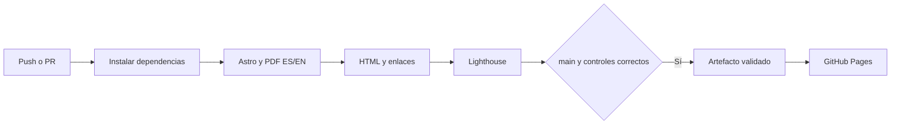

# Portafolio — Ana Patricia Medina Aguirre

[](https://github.com/AnaMedinaAguirre/AnaMedinaAguirre.github.io/actions/workflows/pages.yml)

Portafolio estático de Datos y Automatización con Astro, español/inglés, tema claro/oscuro y CV generado desde los mismos datos que la web.

```
data/cv.es.json, cv.en.json   contenido del portafolio y CV
src/components/              secciones y diagramas
src/i18n/                    textos de interfaz por idioma
src/pages/                   /, /en/, /cv/, /en/cv/
public/                      estilos, JS, fuentes e imágenes
scripts/generate-pdfs.mjs    generación de PDF A4
.github/workflows/pages.yml  controles de calidad y publicación
```

## Ver en local

```bash
npm ci
npx playwright install chromium
npm run dev
```

Requiere Node.js 22 (22.12 o posterior). En PowerShell puedes usar `npm.cmd` y `npx.cmd` si la política de scripts bloquea los comandos habituales.

## Generar web y CV

Edita los JSON de `data/`. El build valida su esquema y paridad estructural por idioma; Astro genera el contenido como HTML estático. Playwright imprime las páginas del CV para producir ambos PDF.

```sh
npm run build:all
npm run preview
```

Usa `build:all` para publicar: `build` por sí solo no genera PDF. Los resultados están en `dist/`; los PDF en `dist/assets/`. Estos archivos generados no se versionan.

## CI/CD



El workflow valida cada push a `v2` o `main`, los PR hacia `main` y ejecuciones manuales. Solo publica desde `main`, usando `actions/deploy-pages` y el mismo artefacto que pasó las comprobaciones.

- **HTML:** preset `html-validate:recommended`. Solo se exceptúan formato de elementos vacíos, espacios finales y longitud editorial del título; las reglas estructurales siguen activas.
- **Enlaces:** lychee revisa archivos internos y anclas en modo offline, y después enlaces externos con reintentos. Las URLs absolutas del propio dominio se mapean a `dist/`, para comprobar el contenido nuevo antes de publicarlo. LinkedIn y WhatsApp quedan excluidos por sus bloqueos a verificadores y requieren revisión manual. No se envían correos ni se hacen llamadas para validar `mailto:` o `tel:`.
- **Lighthouse CI:** tres mediciones de cada una de las cuatro páginas; mínimo **90** en rendimiento, accesibilidad, buenas prácticas y SEO, con la agregación predeterminada de Lighthouse CI. Los informes se guardan como artefactos de Actions durante siete días; no se suben al almacenamiento público de Lighthouse.

Si algún control falla, no se crea el artefacto de Pages ni se ejecuta el despliegue. La validación solo tiene permisos de lectura; los permisos de publicación están limitados al job `deploy`.

Controles locales después de `build:all`:

```sh
npm run check:html
npm run check:lighthouse
```

Lighthouse necesita Chrome instalado; define `CHROME_PATH` si no lo encuentra automáticamente. Los informes locales están en `.lighthouseci/` (ignorado por Git).

La prueba visual `python scripts/check-bilingual.py` requiere Playwright para Python y su Chromium. Genera capturas en `dist/review-phase2/`; vuelve a ejecutar `build:all` antes de publicar para que las capturas no formen parte del sitio.

## Configurar GitHub Pages y proteger main

1. En **Settings → Pages → Source**, selecciona **GitHub Actions**.
2. Sube `v2` con `git push -u origin v2`: ejecutará la validación sin publicar.
3. Tras la primera ejecución, crea una regla para `main` en **Settings → Rules → Rulesets** (o Branches). Exige PR y el control **Build y controles de calidad** antes del merge. Sin esta regla, el workflow impide desplegar un build fallido, pero no impide hacer merge.
4. En el entorno `github-pages`, permite desplegar únicamente desde `main`.
5. Integra `v2` a `main` solo cuando los cambios estén aprobados. Se ejecutará una validación completa antes de publicar.

No hacen falta secretos propios en esta fase: Actions proporciona `GITHUB_TOKEN`. El badge refleja `main` y puede no tener resultados hasta que el workflow exista en esa rama.

## Próximas fases

Pendientes: repositorios desde la API de GitHub, build diario y métricas anónimas con Supabase. Los proyectos personales muestran un estado vacío y no hay métricas inventadas.

### Dependencias de desarrollo

La consulta `npm audit` del 12 de noviembre de 2026 reportó 14 avisos (1 bajo, 12 altos y 1 crítico), incluidos Astro y dependencias transitivas de Lighthouse CI. La web publicada es estática y no incluye `node_modules`, pero las herramientas de desarrollo requieren una revisión de actualización por separado. No se aplicó `npm audit fix --force`, ya que propone cambios de versión mayor. Este audit es informativo y no es uno de los controles bloqueantes del workflow.
