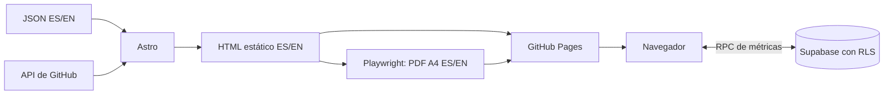
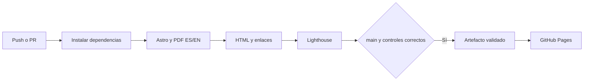
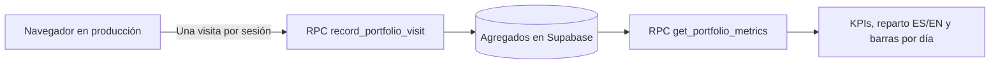

# Portafolio — Ana Patricia Medina Aguirre

[](https://github.com/AnaMedinaAguirre/AnaMedinaAguirre.github.io/actions/workflows/pages.yml)

Portafolio estático de Datos y Automatización con Astro, español/inglés, tema claro/oscuro y CV generado desde los mismos datos que la web.

```
data/cv.es.json, cv.en.json   contenido del portafolio y CV
src/components/              secciones y diagramas
src/i18n/                    textos de interfaz por idioma
src/pages/                   /, /en/, /cv/, /en/cv/
public/                      estilos, JS, fuentes e imágenes
scripts/generate-pdfs.mjs    generación de PDF A4
supabase/                   esquema y verificación de métricas
.github/workflows/pages.yml  controles de calidad y publicación
```

## Arquitectura



## Ver en local

```bash
npm ci
npx playwright install chromium
npm run dev
```

Requiere **Node.js 22** (22.23.4 o posterior, el mínimo de Astro 7), la misma versión que usa Actions. El archivo `.nvmrc` la declara: con [nvm-windows](https://github.com/nvm-windows/nvm) en modo Shim y la detección automática activada, el proyecto usa Node 22 sin cambiar la versión del resto del equipo. Para instalarla: `nvm install 22` y `nvm use 22.x.x` (la versión exacta que muestre `nvm list`).

Con nvm-windows en modo Shim, `npm` y `npx` son ejecutables (`npm.exe`, `npx.exe`): úsalos directamente en PowerShell, sin `.cmd`, y la política de scripts no los bloquea.

Con Node 24.18 en Windows, Astro abortaba al cerrar el build después de una consulta de red (`UV_HANDLE_CLOSING`); con Node 22 termina correctamente.

## Generar web y CV

Edita los JSON de `data/`. El build valida su esquema y paridad estructural por idioma; Astro genera el contenido como HTML estático. Playwright imprime las páginas del CV para producir ambos PDF.

```sh
npm run build:all
npm run preview
```

Usa `build:all` para publicar: `build` por sí solo no genera PDF. Los resultados están en `dist/`; los PDF en `dist/assets/`. Estos archivos generados no se versionan.

## CI/CD



El workflow valida cada push a `v2` o `main`, los PR hacia `main` y ejecuciones manuales. Solo publica desde `main`, usando `actions/deploy-pages` y el mismo artefacto que pasó las comprobaciones.

- **HTML:** preset `html-validate:recommended`. Solo se exceptúan formato de elementos vacíos, espacios finales y longitud editorial del título; las reglas estructurales siguen activas.
- **Enlaces:** lychee revisa archivos internos y anclas en modo offline, y después enlaces externos con reintentos. Las URLs absolutas del propio dominio se mapean a `dist/`, para comprobar el contenido nuevo antes de publicarlo. LinkedIn y WhatsApp quedan excluidos por sus bloqueos a verificadores y requieren revisión manual. No se envían correos ni se hacen llamadas para validar `mailto:` o `tel:`.
- **Lighthouse CI:** tres mediciones de cada una de las cuatro páginas; mínimo **90** en rendimiento, accesibilidad, buenas prácticas y SEO, con la agregación predeterminada de Lighthouse CI. Los informes se guardan como artefactos de Actions durante siete días; no se suben al almacenamiento público de Lighthouse.

Si algún control falla, no se crea el artefacto de Pages ni se ejecuta el despliegue. La validación solo tiene permisos de lectura; los permisos de publicación están limitados al job `deploy`.

Controles locales después de `build:all`:

```sh
npm run check:html
npm run check:lighthouse
```

Lighthouse necesita Chrome instalado; define `CHROME_PATH` si no lo encuentra automáticamente. Los informes locales están en `.lighthouseci/` (ignorado por Git).

La prueba visual `python scripts/check-bilingual.py` requiere Playwright para Python y su Chromium. Genera capturas en `.lighthouseci/review-final/`, fuera del directorio publicado.

## Configurar GitHub Pages y proteger main

1. En **Settings → Pages → Source**, selecciona **GitHub Actions**.
2. Sube `v2` con `git push -u origin v2`: ejecutará la validación sin publicar.
3. Tras la primera ejecución, crea una regla para `main` en **Settings → Rules → Rulesets** (o Branches). Exige PR y el control **Build y controles de calidad** antes del merge. Sin esta regla, el workflow impide desplegar un build fallido, pero no impide hacer merge.
4. En el entorno `github-pages`, permite desplegar únicamente desde `main`.
5. Integra `v2` a `main` solo cuando los cambios estén aprobados. Se ejecutará una validación completa antes de publicar.

Actions proporciona `GITHUB_TOKEN`. La integración de métricas requiere además los dos valores públicos de Supabase documentados abajo. El badge refleja `main` y puede no tener resultados hasta que el workflow exista en esa rama.

## Proyectos personales desde GitHub

Durante el build, `src/lib/github.mjs` consulta los repositorios públicos del usuario indicado en `contacto.github.usuario` de los JSON. Recorre todas las páginas de la API (100 repositorios por página), selecciona los que tienen el topic `portfolio` y los ordena por última actualización. ES/EN comparten la consulta durante el mismo build.

Cada tarjeta muestra nombre, descripción, lenguaje principal y topics (sin la etiqueta de selección `portfolio`), fecha, código y demo si `homepage` tiene una URL HTTP/HTTPS válida. Los botones y las fechas se adaptan a ES/EN. Si falta la descripción, aparece `[PENDIENTE]` / `[PENDING]`. Si no hay repositorios seleccionados, se mantiene el estado vacío.

La descripción de GitHub está en un solo idioma. Para traducirla, agrega el repositorio en `data/repos.overrides.json`:

```json
{ "nombre-del-repo": { "es": { "description": "…" }, "en": { "description": "…" } } }
```

Sin entrada para un idioma se muestra la descripción original. El repositorio de este sitio (`AnaMedinaAguirre.github.io`) se presenta como un proyecto más: en lugar de "Ver demo", que abriría la misma página, su tarjeta lleva a la sección de métricas en vivo (`#metricas`).

Para añadir un proyecto sin modificar la web:

1. Publica un repositorio en tu cuenta de GitHub.
2. En la página del repo, abre el engranaje junto a **About**.
3. Completa **Description**, **Website** (opcional, para la demo) y **Topics**.
4. Incluye el topic `portfolio` y las etiquetas técnicas que quieras mostrar; guarda los cambios.
5. La siguiente compilación lo incluirá. Para quitarlo del portafolio, retira el topic `portfolio`.

El workflow ejecuta el proceso completo todos los días a las **11:17 UTC (06:17 de Lima)**. El cron se activará cuando este workflow llegue a `main`, que debe ser la rama predeterminada; en `v2` se verifica mediante push. Los horarios de Actions pueden retrasarse. En repositorios públicos, GitHub puede desactivar las ejecuciones programadas tras 60 días sin actividad.

En Actions se pasa `GITHUB_TOKEN` únicamente al paso de build; nunca se incluye en HTML ni JavaScript del navegador. En local la consulta funciona sin token, con los límites de la API pública; puedes definir `GITHUB_TOKEN` en tu entorno si necesitas más cuota. No guardes claves en archivos versionados.

Un error HTTP, timeout o respuesta inválida hace fallar el build y bloquea el despliegue: no se presenta como si la cuenta estuviera vacía. El sitio ya publicado permanece disponible. Para probar selección, paginación y fallos sin consumir la API:

```sh
npm run test:github
```

## Métricas anónimas con Supabase



`supabase/metrics.sql` contiene el esquema completo, la política RLS y las dos funciones. Ejecuta el archivo completo en SQL Editor. `supabase/verify-metrics.sql` permite revisar permisos y leer como `anon` sin insertar visitas.

- `portfolio_daily_visits`: clave `(day, page, lang)` y contador `visits`; día calculado en el servidor con zona `America/Lima`.
- RLS activo y `SELECT` permitido a `anon`. Se revocan permisos directos de escritura y no se crean políticas de inserción, actualización o borrado para visitantes.
- `record_portfolio_visit`: función `SECURITY DEFINER` con `search_path` vacío. Acepta solo las parejas `/`–`es` y `/en/`–`en`, y realiza un incremento atómico. El visitante no puede elegir fecha ni contador. Solo se concede ejecución explícita a `anon`.
- `get_portfolio_metrics`: `SECURITY INVOKER`, conserva RLS y devuelve totales globales, últimos 30 días (hoy y 29 anteriores), una serie de 30 días completada con ceros, `first_day` (primer día con visitas, o `null`) y `by_lang` (totales históricos `{ es, en }`).

> **Actualización del 12/11/2026.** Si tu base se creó antes de esa fecha, ejecuta una vez `supabase/2026-11-12-metricas-por-idioma.sql` en SQL Editor: agrega `first_day` y `by_lang` sin tocar la tabla ni los permisos. Hasta entonces el sitio sigue funcionando: el gráfico arranca en el primer día con visitas de la serie y el KPI de idioma indica que está pendiente de la actualización.

El navegador envía únicamente página e idioma, sin parámetros de URL, identificadores de visitante, cookies, IP ni user-agent en la tabla. No se crean usuarios de Supabase Auth. El filtro básico de bots examina el navegador localmente, sin guardar su user-agent. Como cualquier servicio web, la infraestructura de alojamiento puede procesar IP y registros técnicos; la promesa de anonimato describe los datos que almacena esta aplicación.

El conteo se inicia al abrir la portada en el dominio de producción. Se excluyen bots reconocibles, automatización (`navigator.webdriver`), localhost y los CV, para no contar pruebas ni generación de PDF. Una marca en `sessionStorage` evita contar de nuevo al recargar o cambiar de idioma dentro de la misma sesión de pestaña. Si el almacenamiento está bloqueado, se omite el conteo y sigue funcionando la lectura. No representa personas únicas: otra pestaña o sesión puede contar otra visita. La deduplicación es del navegador; una RPC pública puede recibir llamadas automatizadas directas, por lo que las cifras son orientativas y no ofrecen protección estricta contra abuso.

Las cifras se consultan al acercarse a la sección. Mientras cargan se muestra un esqueleto (sin animación si el sistema pide reducir el movimiento); ante un error, un estado explícito con **Reintentar**. Nunca se sustituyen errores por ceros: un cero solo se muestra si lo devuelve la base.

La tarjeta muestra tres KPIs (visitas totales, últimos 30 días y reparto ES/EN) y un gráfico de barras por día:

- El eje empieza en la primera visita ("Recolectando datos desde el …") y cubre como máximo los últimos 30 días.
- Las fechas son legibles ("12 nov" / "Nov 12") y nunca se solapan: con muchos días se muestran espaciadas.
- El valor aparece sobre las barras con visitas mientras sean pocas (hasta 12); con más, solo sobre el máximo y el último día, para no saturar el gráfico.
- Cada barra tiene tooltip con el puntero y con el teclado (el gráfico recibe foco; ← → Inicio Fin para moverse y Escape para cerrar), anunciado a lectores de pantalla.
- **Ver los datos en una tabla** ofrece los mismos valores sin depender del gráfico.
- Los colores de las barras y del reparto ES/EN (`--chart-1`, `--chart-2`) se validaron para cada tema: banda de luminosidad, croma, separación para daltonismo y contraste.

Los datos de GitHub y del CV siguen siendo HTML estático aunque la consulta de métricas falle.

### Configurar valores públicos

1. Crea un proyecto Free en Supabase con Data API activada. Desactiva la exposición automática de tablas y activa RLS automático.
2. Ejecuta `supabase/metrics.sql` y después `supabase/verify-metrics.sql` en SQL Editor. (`metrics.sql` ya incluye la actualización del 12/11/2026; no hace falta el archivo de migración en una base nueva.)
3. En el inicio del proyecto copia la URL `https://<referencia>.supabase.co` (no la URL del dashboard).
4. En **API Keys** copia la clave **Publishable** (`sb_publishable_…`). Nunca uses Secret, `service_role` ni la contraseña de base de datos en el sitio.
5. En GitHub, **Settings → Secrets and variables → Actions → Repository secrets**, crea `PUBLIC_SUPABASE_URL` y `PUBLIC_SUPABASE_PUBLISHABLE_KEY`.
6. El workflow pasa ambos valores al build y verifica las RPC y los permisos por HTTP, sin generar visitas. Si falla esta comprobación, se bloquea el despliegue. En `main` exige configuración; en PR de forks sin secretos se permite compilar sin métricas.

Aunque estén guardados como GitHub Secrets, estos dos valores están diseñados para ser públicos y se incluyen en la web. La protección de la base depende de los permisos y RLS, no de ocultar la clave Publishable. La aplicación rechaza claves que no tengan el formato Publishable. Usa Node 22 como en Actions.

Para desarrollo local copia `.env.example` a `.env` y completa solo esos dos valores públicos. `.env` está ignorado por Git. Sin configuración, el sitio compila y muestra el estado no disponible. Las visitas locales no incrementan la base.

### Validar la fase 5

```sh
npm run test:metrics
python scripts/check-metrics.py
node scripts/verify-supabase.mjs
```

La prueba de navegador requiere el build en `dist/`, Playwright para Python y Chromium; intercepta las RPC con datos simulados y no accede a Supabase real. Sus capturas quedan en `.lighthouseci/review-phase5/`. Comprueba cifras, barras, tabla, estado sin visitas, error con reintento, bots, almacenamiento bloqueado, deduplicación al recargar y al cambiar de idioma. Los datos de las pruebas no se publican.

La verificación HTTP real usa variables de entorno; en local, `node` no carga `.env` automáticamente (puedes usar `node --env-file=.env scripts/verify-supabase.mjs`). Verifica lectura, rechazo de escritura directa mediante operaciones vacías o sin filas coincidentes, y rechazo de una ruta inválida. No invoca el incremento con una página válida ni crea visitas de prueba.

## Pruebas finales y publicación

Instala las herramientas de navegador para Python si todavía no están disponibles:

```sh
python -m pip install playwright
python -m playwright install chromium
```

Con Node 22 y el build completo generado:

```sh
npm run build:all
npm run test:github
npm run test:metrics
npm run check:html
python scripts/check-bilingual.py
python scripts/check-metrics.py
npm run check:lighthouse
```

La revisión bilingüe cubre 1440 y 375 px, ES/EN y claro/oscuro: cambio y persistencia del tema, selector y memoria de idioma, conservación de anclas, menú móvil (Escape y selección), filtros, enlaces internos y descarga de los dos PDF (incluida su cabecera binaria). Comprueba también los CV sin tablas, su ancho móvil y la ocultación de la barra al imprimir.

Las capturas quedan en `.lighthouseci/review-final/` y `.lighthouseci/review-phase5/`, fuera de `dist/`. El resumen de validación y los límites de las pruebas están en [docs/VALIDACION.md](docs/VALIDACION.md).

Cuando el commit de la fase 6 esté aprobado y los controles de `v2` pasen:

1. Abre un PR con base `main` y compare `v2`.
2. Espera el control requerido **Build y controles de calidad**.
3. Tras aprobar la publicación, utiliza **Create a merge commit** para conservar un commit por fase. Evita Squash si quieres mantener ese historial.
4. Comprueba que la ejecución de `main` termine con **Publicar en GitHub Pages** en verde.
5. Revisa en producción `/`, `/en/`, `/cv/`, `/en/cv/` y ambas descargas. Comprueba las métricas desde un navegador normal: las pruebas automáticas no incrementan visitas. Confirma también el entorno `github-pages` limitado a `main`.

El primer despliegue y la ejecución real del cron están pendientes hasta la aprobación del merge. Los controles validan el sitio antes de publicar, pero no sustituyen esa comprobación posterior.

### Dependencias de desarrollo

El sitio usa **Astro 7**. La actualización desde Astro 5 (12/11/2026) no cambió el resultado: las 16 capturas de comparación (4 rutas × escritorio/móvil × claro/oscuro) son idénticas píxel a píxel y el HTML solo difiere en la forma de escribir `&` en dos metadatos. Dos ajustes la hicieron posible:

- `compressHTML: true` en `astro.config.mjs`: Astro 7 cambió el valor por defecto a `'jsx'`, que elimina espacios entre elementos en línea.
- Zod 4 (`astro/zod`): `z.email()` y `z.url()` en lugar de los formatos obsoletos de `z.string()`.

`npm audit` no reporta vulnerabilidades. Las que quedaban venían de `basic-ftp` 5.x, que Lighthouse CI arrastra a través de `proxy-agent` → `get-uri`; toda esa cadena ya está en su última versión y `get-uri` aún exige la 5.x. Por eso `package.json` incluye un `overrides` que fuerza `basic-ftp` 6.2.6 (corrige tres fallos de denegación de servicio del cliente FTP). Ese cliente solo se usaría al descargar por `ftp://`, algo que Lighthouse no hace aquí; se comprobó que carga correctamente y Lighthouse CI funciona igual. Cuando `get-uri` adopte la versión 6, el override se puede quitar.

No uses `npm audit fix --force`: propone cambios de versión mayor sin control. El audit es informativo y no es un control bloqueante del workflow.
